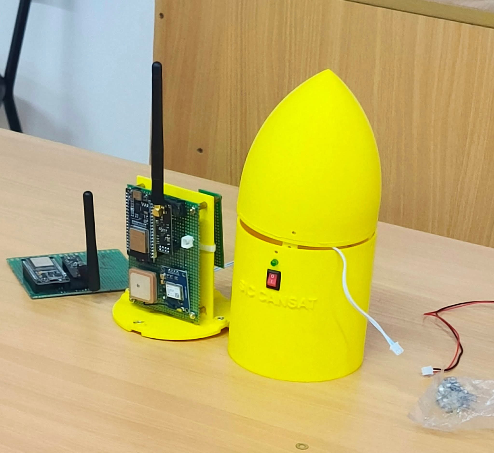
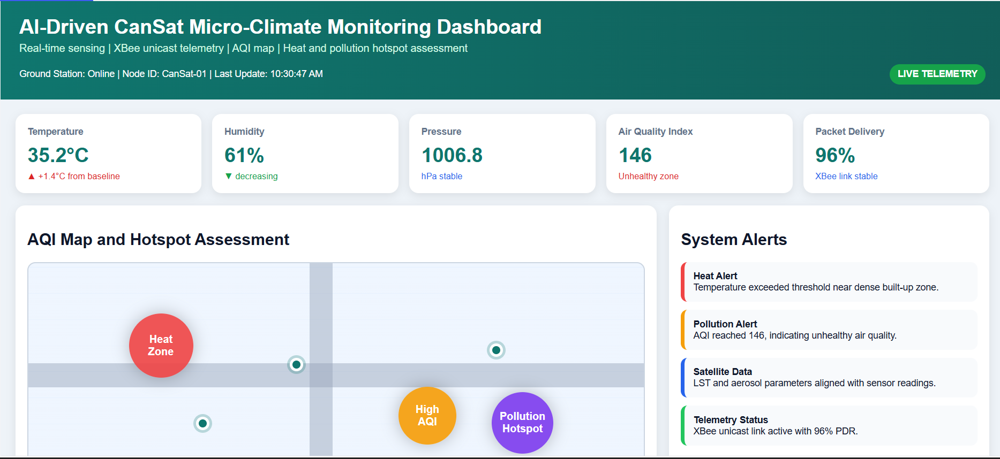
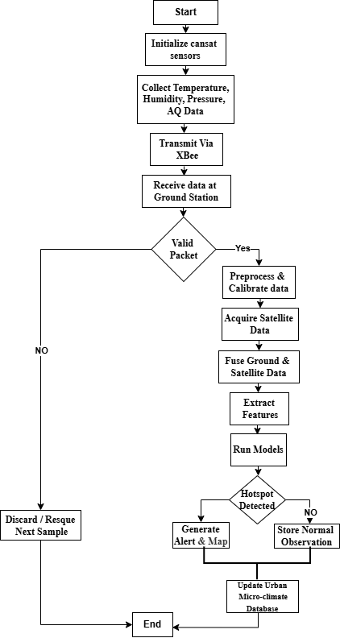
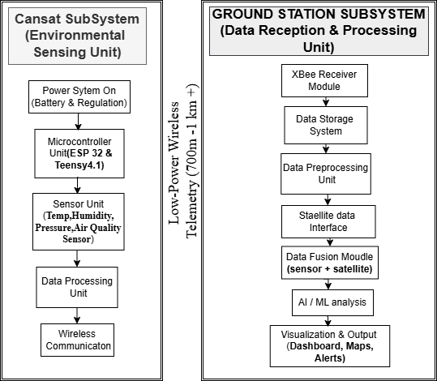
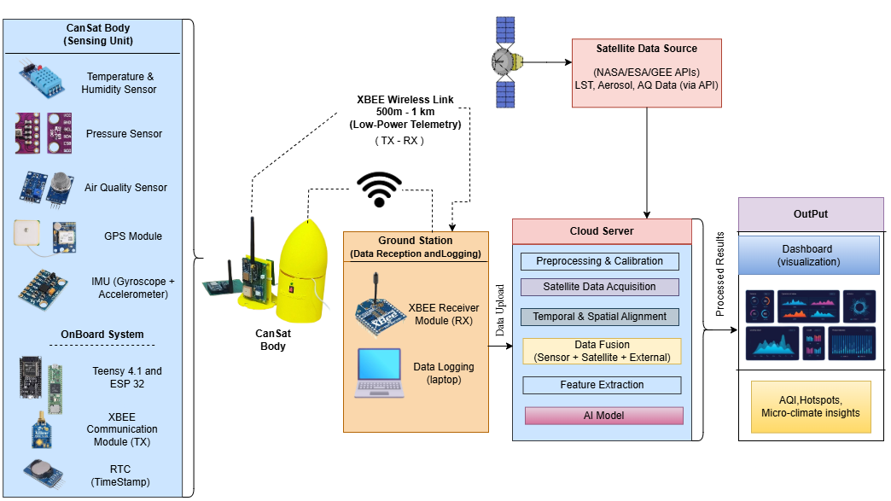
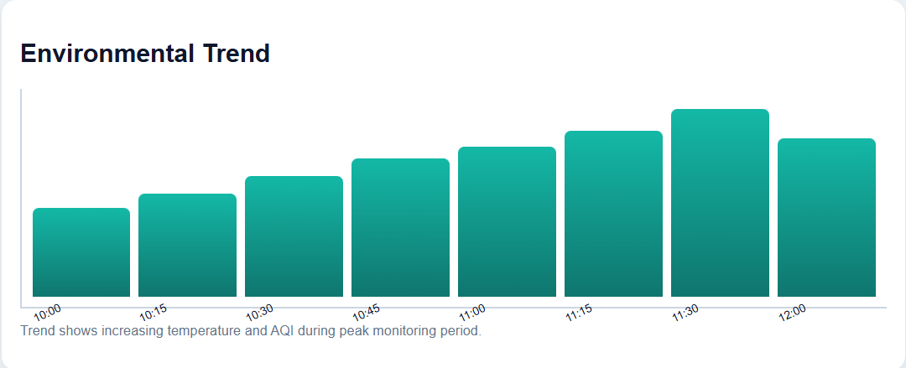
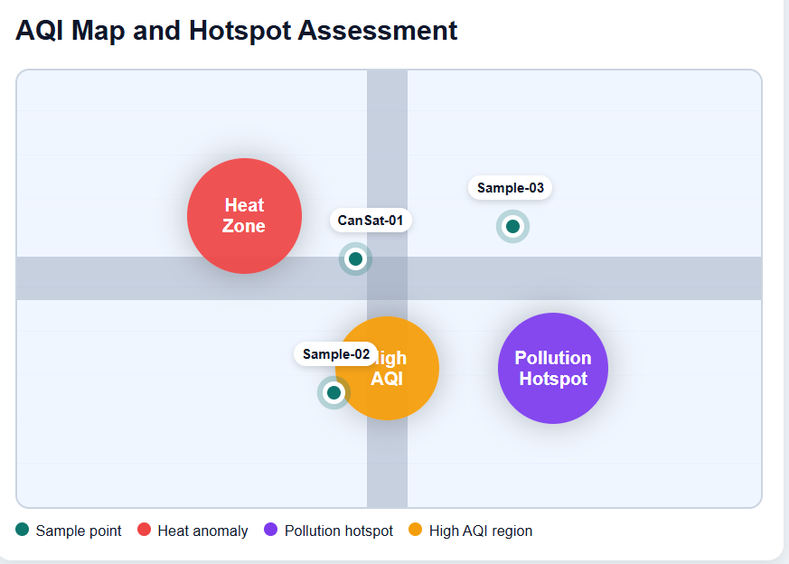
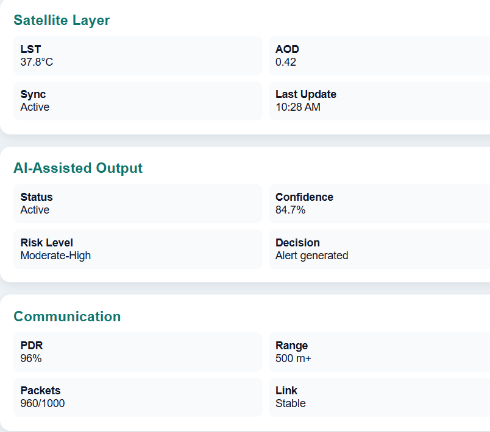

# AI-Driven CanSat-Based Framework for Urban Microclimate Monitoring and Environmental Anomaly Detection

[](conference_latex_template/cansat.tex)
[](#hardware-specifications)
[](#machine-learning--analytics-pipeline)
[-yellow.svg)](#communication-architecture)
[-purple.svg)](https://www.uiu.ac.bd)
[](LICENSE)
[](https://github.com/isratjahanrani)

An intelligent, low-cost, airborne sensing and spatial analytics framework combining a **CanSat payload**, **long-range wireless telemetry**, **satellite remote sensing data fusion**, and **edge machine learning models** to detect hyperlocal microclimate variations, urban heat islands (UHI), and air pollution hotspots in megacities.

---

<p align="center">
  
  
</p>

---

## Table of Contents

- [Overview](#overview)
- [Key Features](#key-features)
- [System Architecture](#system-architecture)
- [Hardware Specifications](#hardware-specifications)
- [Communication Architecture](#communication-architecture)
- [Multi-Source Data Fusion Pipeline](#multi-source-data-fusion-pipeline)
- [Machine Learning & Analytics Pipeline](#machine-learning--analytics-pipeline)
- [Experimental Results & Validation](#experimental-results--validation)
- [Ground Station Dashboard](#ground-station-dashboard)
- [Repository Structure](#repository-structure)
- [Compilation & Usage](#compilation--usage)
- [Research Team & Authors](#research-team--authors)
- [Citation](#citation)
- [License & Acknowledgments](#license--acknowledgments)

---

## Overview

Rapid urbanization and high-density infrastructure in modern megacities give rise to severe environmental challenges, including localized **Urban Heat Island (UHI)** effects, particulate matter surges, and dynamic microclimatic shifts at spatial scales below 500 meters. 

Existing observation techniques face fundamental trade-offs:
- **Ground Meteorological Stations:** Provide accurate readings but are sparse, stationary, and unable to capture street-level intra-urban heterogeneity.
- **Satellite Remote Sensing:** Offers extensive spatial coverage but suffers from temporal latency, cloud interference, and coarse spatial resolution inadequate for street-level intervention.
- **Centralized IoT Networks:** Require heavy cloud connectivity and high bandwidth, creating latency and communication overhead.

### The CanSat AI Solution
This project introduces a **distributed, low-power airborne sensing framework** built within a standard CanSat form factor. The CanSat collects vertical atmospheric profiles and low-altitude (500 m – 1 km) localized environmental data, streams it via low-power wireless telemetry to an edge ground station, and fuses real-time measurements with satellite-derived contextual features for automated microclimate classification, anomaly detection, and hotspot mapping.

---

## Key Features

- **Low-Altitude Airborne Atmospheric Profiling:** Captures continuous vertical measurements of temperature, relative humidity, barometric pressure, particulate matter, and harmful gas concentrations during controlled descent.
- **Multi-Source Feature Fusion:** Formally merges hyperlocal CanSat telemetry ($D_c$) with macroscopic satellite earth-observation data ($D_s$) into a unified multi-dimensional feature vector.
- **Intelligent Edge Anomaly Detection:** Utilizes **Isolation Forest** to flag environmental anomalies and sensor fluctuations with ~**84.7% accuracy** and ultra-low inference latency (**18–25 ms**).
- **Urban Hotspot Scoring Engine:** Computes weighted composite risk scores to identify urban heat-stress zones and severe air pollution hotspots.
- **High-Reliability Telemetry with Dual Storage:** Employs XBee point-to-point unicast telemetry with **94%–98% Packet Delivery Ratio (PDR)** up to 1 km, coupled with onboard flash logging for complete post-recovery auditability.
- **Interactive Decision-Support Dashboard:** Renders real-time telemetry gauges, spatial AQI heatmaps, satellite sync indicators, and automated warning systems for municipal authorities and urban planners.

---

## System Architecture

The framework is organized into three interconnected layers:
1. **CanSat Airborne Sensing Subsystem:** Low-power sensor payload, flight computer, and telemetry transmitter.
2. **Ground Station Edge Subsystem:** Radio transceiver, real-time packet parsing, noise filtering, and data logging.
3. **Cloud & Analytics Processing Subsystem:** Satellite data synchronization, multi-source feature fusion, machine learning inference, and spatial dashboard visualization.

<p align="center">
  
</p>

### Detailed Subsystem Workflow

<p align="center">
  
</p>

```
┌────────────────────────────────────────────────────────┐
│                   Urban Environment                    │
└───────────────────────────┬────────────────────────────┘
                            │
                            ▼
┌────────────────────────────────────────────────────────┐
│                 CanSat Airborne Node                   │
│   • BME680 (Temp, Humidity, Pressure, Gas)             │
│   • MQ-135 (Air Quality / Pollutants)                  │
│   • GPS (Latitude, Longitude, Altitude, RTC)           │
│   • 6-DOF IMU (Flight Dynamics & Attitude)             │
│   • Teensy 4.1 / ESP32 Controller                      │
└───────────────────────────┬────────────────────────────┘
                            │ XBee Unicast Telemetry (500m - 1km)
                            ▼
┌────────────────────────────────────────────────────────┐
│                 Ground Station Edge                    │
│   • Packet Reception & Integrity Verification          │
│   • Sensor Calibration & Noise Filtering               │
│   • Dual-Storage Validation                            │
└───────────────────────────┬────────────────────────────┘
                            │
                            ▼
┌────────────────────────────────────────────────────────┐
│            Contextual & Satellite Fusion               │
│   • NASA / ESA / Google Earth Engine (LST, AOD, NDVI)  │
│   • Spatiotemporal Alignment & Feature Fusion          │
│   • Fused Vector: F = D_c ⊕ D_s                        │
└───────────────────────────┬────────────────────────────┘
                            │
                            ▼
┌────────────────────────────────────────────────────────┐
│                 Ground AI Intelligence                 │
│   • Microclimate Classification (Random Forest)        │
│   • Anomaly Detection (Isolation Forest)               │
│   • Multi-Criteria Hotspot Scoring                     │
└───────────────────────────┬────────────────────────────┘
                            │
                            ▼
┌────────────────────────────────────────────────────────┐
│            Decision Support & Visualization            │
│   • Live Telemetry Gauges & Communication Health       │
│   • Hyperlocal AQI Spatial Contour Map                 │
│   • Environmental Risk Alerts for Smart Cities         │
└────────────────────────────────────────────────────────┘
```

---

## Hardware Specifications

| Component | Model / Specification | Purpose in System |
| :--- | :--- | :--- |
| **Main Processing Unit** | Teensy 4.1 / ESP32 | Onboard data acquisition, filtering, packetization, and scheduling |
| **Environmental Sensor** | Bosch BME680 | Temperature, relative humidity, barometric pressure, gas resistance |
| **Air Quality Sensor** | MQ-135 | Carbon monoxide, nitrogen oxides, ammonia, benzene, smoke |
| **Localization Module** | GPS Receiver (NEO-6M / compatible) | 3D geographic positioning (latitude, longitude, altitude) and UTC timestamps |
| **Inertial Measurement** | 6-DOF IMU (MPU6050 / compatible) | Accelerometer and gyroscope data for descent stability tracking |
| **Wireless Telemetry** | Digi XBee Pro (2.4 GHz) | Point-to-point unicast data streaming (500 m – 1 km line-of-sight) |
| **Power Supply** | Rechargeable Li-Po (3.7V / regulated) | Low-power operation (1.9 W – 2.3 W), providing up to 100 min runtime |
| **Recovery System** | Parachute / Aerodynamic Drag Mechanism | Controlled descent rate to preserve sensor sampling fidelity |

---

## Communication Architecture

The system uses an **XBee unicast point-to-point wireless telemetry link**, optimized for low-latency transmission and battery longevity.

### Telemetry Packet Delivery Performance

| Deployment Distance | Packet Delivery Ratio (PDR) | Link Status | Operational State |
| :---: | :---: | :---: | :--- |
| **100 m** | **98%** | Stable | Optimal airborne telemetry |
| **300 m** | **97%** | Stable | Excellent line-of-sight |
| **500 m** | **96%** | Stable | Reliable urban communication |
| **700 m** | **95%** | Moderate | Urban building interference mitigated |
| **1000 m (1 km)** | **94%** | Acceptable | Maximum operational radius |

**Data Integrity via Dual-Storage:**
In addition to live telemetry over the air, an onboard flash backup records every reading. Following payload retrieval, ground logs are matched against onboard logs to ensure complete recovery of any dropped packets.

---

## Multi-Source Data Fusion Pipeline

To overcome the spatial limitations of isolated sensor nodes and the temporal limitations of orbital satellites, the framework performs **feature-level data fusion**:

$$\mathbf{F} = \mathbf{D}_c \oplus \mathbf{D}_s$$

Where:
- $\mathbf{F}$: Integrated environmental feature vector.
- $\mathbf{D}_c$: Real-time CanSat observations $[\text{Temp}, \text{Humidity}, \text{Pressure}, \text{Gas/AQI}, \text{PM}_{2.5}, \text{PM}_{10}, \text{Lat}, \text{Lon}, \text{Alt}, \text{Time}]$.
- $\mathbf{D}_s$: Macro-level satellite & contextual features $[\text{LST}, \text{AOD}, \text{NDVI}, \text{LULC}, \text{Urban Density}]$.
- $\oplus$: Concatenation and spatiotemporal alignment operator.

<p align="center">
  
</p>

---

## Machine Learning & Analytics Pipeline

The AI module is hosted at the ground station layer to minimize payload weight and battery draw while enabling high-throughput inference.

```
                         ┌─────────────────────────┐
                         │   Fused Vector: F       │
                         └────────────┬────────────┘
                                      │
              ┌───────────────────────┼───────────────────────┐
              ▼                       ▼                       ▼
   ┌────────────────────┐  ┌────────────────────┐  ┌────────────────────┐
   │ Microclimate State │  │ Anomaly Detection  │  │  Hotspot Scoring   │
   │   Classification   │  │                    │  │                    │
   │  (Random Forest)   │  │ (Isolation Forest) │  │(Multi-Criteria Wtd)│
   └──────────┬─────────┘  └──────────┬─────────┘  └──────────┬─────────┘
              │                       │                       │
              ▼                       ▼                       ▼
       Predicted Class        Anomaly Flag (0/1)        Hotspot Severity
    (Normal, Heat-Stress,    (Sudden Gas Spike /       (Low, Moderate,
     Polluted, Anomalous)     Unusual Temp Jump)           Extreme)
```

### 1. Microclimate State Classification
- **Primary Model:** Random Forest Classifier trained on fused environmental parameters.
- **Target States:** `Normal Condition`, `Heat-Stress Zone`, `Polluted Zone`, `High-Humidity Zone`, and `Anomalous Condition`.
- **Baseline Comparisons:** Benchmarked against Decision Trees, Support Vector Machines (SVM), and Logistic Regression.

### 2. Environmental Anomaly Detection
- **Algorithm:** Isolation Forest.
- **Role:** Identifies localized toxic emission bursts, rapid thermal inversions, or abnormal sensor deviations without requiring prior manual labeling.

### 3. Multi-Criteria Hotspot Identification
- Computes a composite hotspot index using calibrated sensor weights (Temperature, PM concentration, gas levels, and satellite Land Surface Temperature).

### Benchmark Datasets for Pre-Validation
Before field deployment, the machine-learning pipeline was trained and validated using standard benchmark datasets:
1. **Hourly Air Quality Index (AQI) of Bangladesh** (Kaggle)
2. **Dhaka Daily Air Quality and Weather Dataset** (Kaggle)
3. **Urban Heat Island (UHI) Monitoring Dataset** (Kaggle)

---

## Experimental Results & Validation

Field prototype deployments in high-density urban environments demonstrated high sensitivity to microclimate variability:

- **Hyperlocal Thermal Detection:** Detected temperature variations of **5–7 °C within a 500-meter radius**, invisible to regional meteorological stations.
- **Pollution Spike Sensitivity:** Captured localized particulate surges of **15–22%** induced by traffic junctions and localized industrial activities.
- **AI Model Performance:** Achieved **~84.7% anomaly detection accuracy** with an inference latency of **18–25 ms**.
- **Energy Budget:** System power draw remained between **1.9 W and 2.3 W**, delivering over **100 minutes** of continuous operation on battery power.

<p align="center">
  
  <br />
  <em>Temporal variation in Temperature and AQI recorded during urban test missions.</em>
</p>

---

## Ground Station Dashboard

The interactive ground station dashboard is organized into specialized analytical panels:

<p align="center">
  
</p>

### Key Dashboard Modules

| Module | Visual | Functionality |
| :--- | :---: | :--- |
| **AQI & Hotspot Spatial Mapping** |  | Color-coded spatial zoning showing localized heat anomalies, dangerous AQI pockets, and geographic sample pins. |
| **Satellite Synchronization & AI Diagnostics** |  | Displays satellite LST/AOD sync status, AI confidence levels, alert levels, and live telemetry link health (PDR, RSSI). |

---

## Repository Structure

```
├── README.md                           # Comprehensive documentation and project guide
├── LICENSE                             # MIT Open-Source License
├── .gitignore                          # Standard LaTeX, Python, and OS ignore rules
├── assets/                             # Documentation assets and paper figures
│   ├── aqi_hotspot_map.png             # Hyperlocal spatial AQI and hotspot contour map
│   ├── environmental_trend.png         # Temporal trend graph of temperature & AQI
│   ├── ground_station.png              # Ground station architecture diagram
│   ├── ground_station_dashboard.png    # Live ground station telemetry interface
│   ├── hardware_cansat.jpeg            # Photograph of the fabricated CanSat payload
│   ├── methodology_workflow.png        # Complete data pipeline and AI workflow
│   ├── satellite_ai_comm.png           # Satellite sync and communication metrics
│   ├── subsystem_design.png            # Detailed hardware and ground station subsystems
│   └── system_architecture.png         # Overall multi-tier system architecture
├── conference_latex_template/          # IEEE Conference Paper LaTeX sources (Latest)
│   ├── cansat.tex                      # Complete LaTeX paper source code
│   ├── cas-refs.bib                    # BibTeX bibliography references
│   ├── IEEEtran.cls                    # IEEE official LaTeX document class
│   ├── IEEE-conference-template-062824.pdf
│   ├── IEEEtran_HOWTO.pdf
│   └── *.png, *.jpeg                   # Source figures referenced in paper
└── cansat_new_template_overleaf.zip    # Ready-to-import Overleaf project archive
```

---

## Compilation & Usage

### 1. Opening in Overleaf
1. Log in to [Overleaf](https://www.overleaf.com/).
2. Click **New Project** $\rightarrow$ **Upload Project**.
3. Upload `cansat_new_template_overleaf.zip`.
4. Set compiler to **pdfLaTeX** and compile `cansat.tex`.

### 2. Compiling Locally (Linux / macOS / Windows)
Make sure you have TeX Live, MacTeX, or MiKTeX installed:

```bash
# Navigate to the LaTeX directory
cd conference_latex_template

# Compile with pdflatex and bibtex
pdflatex cansat.tex
bibtex cansat
pdflatex cansat.tex
pdflatex cansat.tex
```

Or using `latexmk`:
```bash
latexmk -pdf cansat.tex
```

---

## Research Team & Authors

This project was conducted in the **Department of Computer Science and Engineering** at **United International University (UIU)**, Dhaka, Bangladesh:

- **Provat Kundu Shawon** — [pshawon223826@bscse.uiu.ac.bd](mailto:pshawon223826@bscse.uiu.ac.bd)
- **Fahmida Khanam Majumder** — [fmajumder223847@bscse.uiu.ac.bd](mailto:fmajumder223847@bscse.uiu.ac.bd)
- **Israt Jahan Rani** — [irani201376@bscse.uiu.ac.bd](mailto:irani201376@bscse.uiu.ac.bd) | [GitHub Profile](https://github.com/isratjahanrani)
- **Robiul Islam Tamim** — [rtamim212039@bscse.uiu.ac.bd](mailto:rtamim212039@bscse.uiu.ac.bd) | [GitHub Profile](https://github.com/robiultamim)
- **Dr. Md. Motaharul Islam** (Faculty Advisor / Supervisor) — [motaharul@cse.uiu.ac.bd](mailto:motaharul@cse.uiu.ac.bd)

---

## Citation

If you use this work, framework, or dataset concepts in your research, please cite our paper:

```bibtex
@inproceedings{shawon2026cansat,
  title={CanSat-based framework of urban based on AI microclimate monitoring},
  author={Shawon, Provat Kundu and Majumder, Fahmida Khanam and Rani, Israt Jahan and Tamim, Robiul Islam and Islam, Md. Motaharul},
  booktitle={IEEE Conference Proceedings},
  year={2026},
  organization={Department of Computer Science and Engineering, United International University}
}
```

---

## License & Acknowledgments

This project is licensed under the [MIT License](LICENSE).

Special thanks to **United International University (UIU)** for institutional support, laboratory facilities, and guidance throughout this research.
